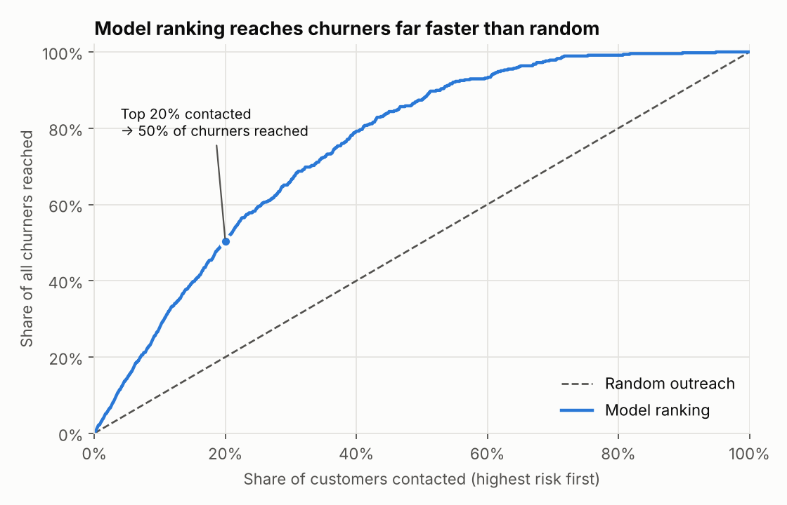
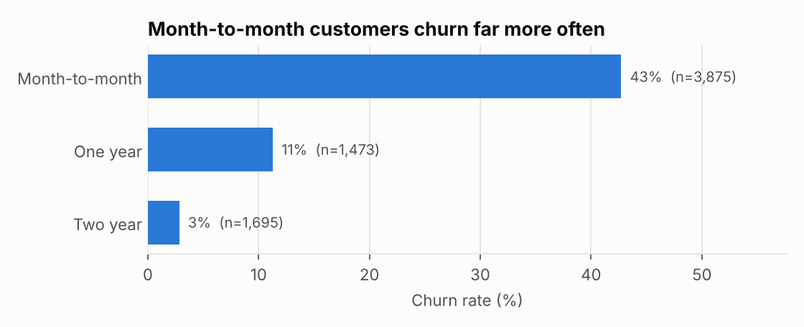
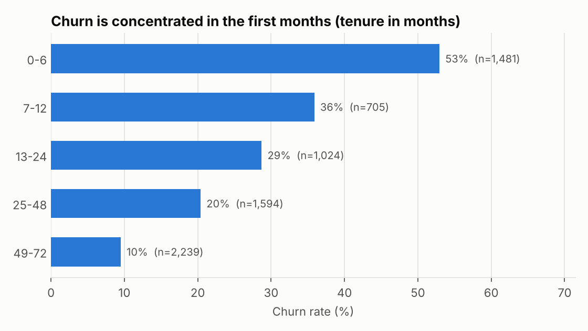
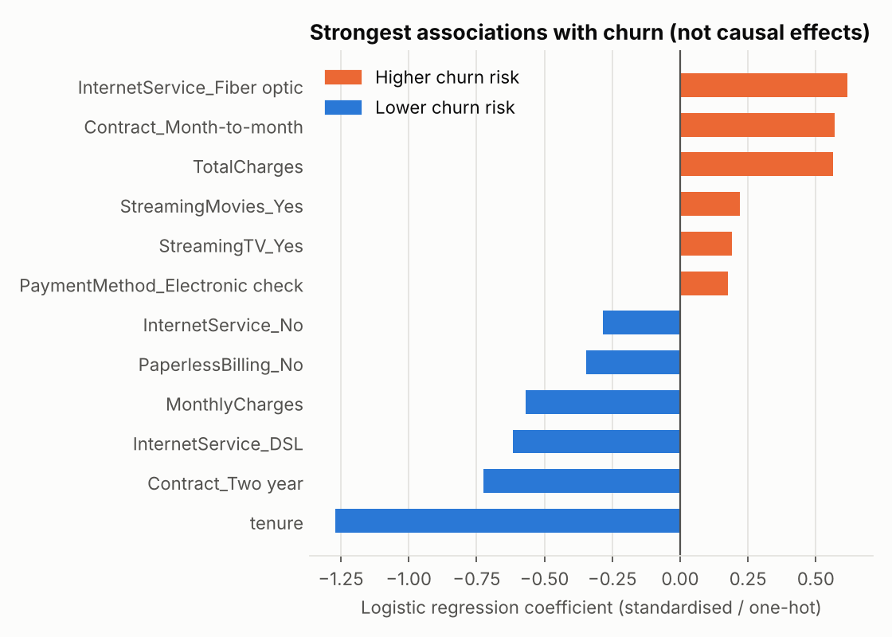

# Telco Customer Churn: Analysis & Prediction

**Python · pandas · scikit-learn · matplotlib · pytest · GitHub Actions**

Which telecom customers are about to leave, and how should a retention team prioritise who to call? This project analyses 7,043 customers from the IBM Telco Customer Churn dataset and builds a model that ranks customers by churn risk.

## Key findings

**If the retention team contacts the 20% of customers with the highest predicted risk, it reaches 50% of all churners, 2.5× better than random outreach.** Among the top 10%, three in four customers (74%) really do churn.



1. **Churn is a big revenue problem.** 26.5% of customers churned, and they account for 30.5% of monthly revenue, because churners pay more per month than average.
2. **Contract type is the clearest dividing line.** Month-to-month customers churn at 43%, compared with 3% on two-year contracts.
3. **The first six months are critical.** Customers with 0–6 months of tenure churn at 53%. After four years it falls to 10%.
4. **Fiber optic and electronic-check customers stand out.** Both groups churn at over 40%, roughly double the average of the other options.




## Model

| Step | Approach |
| --- | --- |
| Split | 75% train / 25% test, stratified. The test set is used once, at the end. |
| Preprocessing | One-hot encoding and scaling inside a scikit-learn `Pipeline`, so nothing leaks between folds. `customerID` is excluded. |
| Model selection | 5-fold stratified cross-validation on the training set: Logistic Regression vs Random Forest. |
| Threshold | Chosen to maximise F1 on out-of-fold training predictions, not on the test set. |

**Cross-validation (training set)**

| Model | ROC-AUC | Average precision |
| --- | ---: | ---: |
| Random Forest | 0.846 ± 0.014 | 0.666 |
| Logistic Regression | 0.844 ± 0.015 | 0.661 |

The difference is smaller than one standard deviation, so **Logistic Regression** was chosen. It performs as well as the forest and is far easier to explain to a business audience.

**Final test-set results (1,761 customers)**

| Metric | Value |
| --- | ---: |
| ROC-AUC | 0.847 |
| Average precision | 0.638 |
| Threshold | 0.33 |
| Precision | 54.5% |
| Recall | 72.6% |

At this threshold the model flags 73% of the customers who churn, and just over half of the flagged customers churn. For a retention campaign, the ranking matters more than one fixed threshold:

| Customers contacted | Churners reached | Hit rate | Lift vs random |
| ---: | ---: | ---: | ---: |
| Top 10% | 28% | 74% | 2.8× |
| Top 20% | 50% | 67% | 2.5× |
| Top 30% | 66% | 59% | 2.2× |



Short tenure, month-to-month contracts and fiber optic service are most strongly associated with churn. These are associations, not causes. `tenure`, `MonthlyCharges` and `TotalCharges` are also correlated with each other, so their individual coefficients should not be over-interpreted.

## How to run

```bash
python -m venv .venv
# Windows: .venv\Scripts\activate
# macOS/Linux: source .venv/bin/activate
pip install -r requirements.txt
python main.py          # runs the analysis, writes figures/ and reports/
python -m pytest -q     # 7 tests; these also run on every push via GitHub Actions
```

## Repository structure

```text
telco-churn-prediction/
├── main.py                  # runs the full pipeline
├── src/
│   ├── data.py              # loading and cleaning
│   ├── analysis.py          # KPIs and segment tables
│   ├── model.py             # CV comparison, threshold, evaluation, gains
│   └── plots.py             # charts
├── tests/                   # pytest tests for cleaning and modelling
├── data/                    # dataset + source and license
├── figures/                 # charts used in this README
├── reports/                 # KPIs, CV results, test metrics, segment tables
├── MODEL_CARD.md
└── .github/workflows/tests.yml
```

## Data and cleaning

- **Source:** IBM Telco Customer Churn sample data, a fictional company created by IBM for teaching. Apache License 2.0. See [data/README.md](data/README.md).
- **`TotalCharges`** is stored as text, and 11 rows contain a blank. All 11 have a tenure of 0, so they are new customers who haven't been billed yet. The blanks are set to 0 rather than dropped, and the cleaning step raises an error if this assumption ever fails.
- No duplicate customer IDs, and no other missing values.

## Limitations

- The data is a single snapshot without dates, so the model can't be validated on later time periods the way a production model should be.
- The threshold optimises F1, not profit. A real campaign would set it from contact costs, offer costs and the value of a retained customer.
- Coefficients describe associations. Whether a contract offer actually *reduces* churn would need an experiment such as an A/B test.

See [MODEL_CARD.md](MODEL_CARD.md) for intended use and risks.
